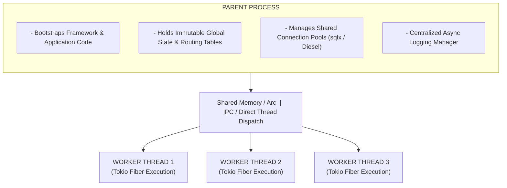

# Language Specification & Architecture Document

## Table of Contents
- [Executive Summary & Design Decisions](#executive-summary--design-decisions)
  - [1. Type System Strategy: Medium (Gradual / Surface-Level Contracts)](#1-type-system-strategy-medium-gradual--surface-level-contracts)
  - [2. Type System & Numeric Datatypes](#2-type-system--numeric-datatypes)
- [Technical Architecture (Performance-First Paradigm)](#technical-architecture-performance-first-paradigm)
  - [Process & Threading Architecture](#process--threading-architecture)
  - [1. Compiler Pipeline & Execution Engine](#1-compiler-pipeline--execution-engine)
  - [2. Standard Library & Explicit Subtype System](#2-standard-library--explicit-subtype-system)
  - [Facade Library Pattern](#facade-library-pattern)
  - [Facade Tiering Architecture](#facade-tiering-architecture)
  - [Facade Extensibility: Runtime Macro Registration vs. Class Inheritance](#facade-extensibility-runtime-macro-registration-vs-class-inheritance)
- [Facades & Utility Helpers](#facades--utility-helpers)
  - [1. Arr Facade](#1-arr-facade)
  - [2. Str Facade](#2-str-facade)
  - [3. HTTP Facade](#3-http-facade)
  - [4. File Facade](#4-file-facade)
  - [5. Session Facade](#5-session-facade)
  - [6. Image Facade](#6-image-facade)
  - [7. URL Facade](#7-url-facade)
- [Asynchronous Non-Blocking Concurrent Core](#asynchronous-non-blocking-concurrent-core)
- [Process Model & Database Pooling](#process-model--database-pooling)
- [Dual-Engine Execution Modes (Development vs Production Mode)](#dual-engine-execution-modes-development-vs-production-mode)
  - [Overview & Execution Modes Strategy](#overview--execution-modes-strategy)
  - [Developer Experience Framework (`rhp run dev`)](#developer-experience-framework-rhp-run-dev)
  - [Implementation Code Sketch](#implementation-code-sketch)
  - [Execution Matrix](#execution-matrix)
- [Technical Language Construction Architecture (20 Technical Points)](#technical-language-construction-architecture-20-technical-points)

---

## Executive Summary & Design Decisions

### 1. Type System Strategy: Medium (Gradual / Surface-Level Contracts)

- **Function & Method Boundaries:** Enforces strict parameter and return types across signatures to guarantee API predictability, IDE intelligence, and compile-time boundary safety.
- **Function Bodies:** Evaluated using dynamic inference and assignment, preserving rapid prototyping, clean syntax, and low syntactic overhead.
- **Reference Mechanics:** Explicit pass-by-reference (`&$var`) is removed in favor of explicit returns and mutable collection wrappers. Objects pass by reference handle, while arrays/strings utilize Copy-On-Write (COW) semantics.
- **Strict Type Safety & No Implicit Type-Shifting:** RHP enforces strict type boundaries akin to Rust. Once a variable holds a specific declared type (e.g. `int $x = 0;`), you cannot implicitly reassign it to an incompatible type (`$x = 'hello';` throws a Rust-style `VariableTypeMismatch` compile/runtime error).

### 2. Type System, Type Hints & Casting Syntax

| Feature | Syntax | Architectural Rationale |
| :--- | :--- | :--- |
| **Type Casting** | `(int)$x`, `(string)$x` | Matches native PHP casting; avoids confusion with object instantiation (`new Class()`) or function invocations. |
| **Scalar Type Hints** | `int $x`, `string $x`, `float $x`, `bool $x` | Strictly lowercase primitive keywords for function boundaries. Capitalized variants (e.g., `String`, `Integer`) are strictly rejected at parse and check time. |
| **Collection Type Hints** | `List $arr`, `Dict $arr`, `Set $arr`, `HashMap $arr` (or lowercase `list`, `dict`, `set`, `hashmap`) | Explicit high-performance collection subtypes backed by dedicated Rust heap structures (`Box<Vec<PhpValue>>`, `Box<IndexMap>`). Enforces strict type boundaries. |
| **Permissive Parent Type** | `array $arr = [1, 2, 3];`<br/>`function myFunc(): array` | Permissive parent collection type for backward compatibility. Accepts all collection variants (`List`, `Dict`, `Set`, `HashMap`) interchangeably behind a memory-safe pointer. |

- **Dynamic Typing via PhpValue & Flexible Reassignment:** Untyped variables (or variables initialized with standard PHP array syntax) store values dynamically under the hood using a unified type enum (`PhpValue`). Developers can easily reassign an untyped or `array`-hinted variable from a sequential list structure to a dictionary or map structure without throwing a type error:
  ```php
  $arr = [1, 2, 3];
  $arr = ['name' => 'yogesh']; // Seamless flexible reassignment

  array $arr = [1, 2, 3];
  $arr = ['name' => 'yogesh']; // Supported via permissive parent array type
  ```
- **Strict Type Bounds vs. Dynamic Variables:** While dynamic flexibility applies to untyped and generic `array`-hinted variables, once a variable or parameter is explicitly type-hinted with a strict collection subtype (like `list $arr` or `dict $arr`) or a primitive scalar (like `int $x`), RHP enforces strict type boundaries and throws a Rust-style value/type error if assigned an incompatible type.
- **Default Integers and Floats:** Default/standard integer and float types use `i32` (`Int` and `Float` wrappers/primitives).
- **Extended Rust Numeric Types & Fluent APIs:** Developers can also use all other native Rust numeric types in our language (such as `i64`, `f64`, `u32`, etc.). They can be constructed and manipulated fluently via type wrappers, e.g.:

```php
Int::i64()->random()->add()->subtract()

Float::i64()->toDecimal(2)
```

---

## Technical Architecture (Performance-First Paradigm)

### Process & Threading Architecture



```text
┌─────────────────────────────────────────────────────────┐
│                     PARENT PROCESS                      │
│ - Bootstraps Framework & Application Code               │
│ - Holds Immutable Global State & Routing Tables         │
│ - Manages Shared Connection Pools (sqlx / Diesel)       │
│ - Centralized Async Logging Manager                     │
└───────────────────────────┬─────────────────────────────┘
                            │
┌───────────────────────────┴─────────────────────────────┐
│ Shared Memory / Arc       │ IPC / Direct Thread Dispatch │
└───────────────────────────┬─────────────────────────────┘
              ┌─────────────┼─────────────┐
              ▼             ▼             ▼
┌───────────────────────┐ ┌───────────────────────┐ ┌───────────────────────┐
│    WORKER THREAD 1    │ │    WORKER THREAD 2    │ │    WORKER THREAD 3    │
│(Tokio Fiber Execution)│ │(Tokio Fiber Execution)│ │(Tokio Fiber Execution)│
└───────────────────────┘ └───────────────────────┘ └───────────────────────┘
```

### 1. Compiler Pipeline & Execution Engine

- **Lexer:** Powered by `logos` for ultra-fast, deterministic finite automata (DFA) tokenization.
- **Parser:** Custom Pratt Parser combined with expression combinators to generate a typed Abstract Syntax Tree (AST).
- **Execution Model:** Lowers AST into a linear Intermediate Representation (IR) opcode stream executed by a register-based Bytecode VM written natively in Rust. Hot paths can be conditionally JIT-compiled via Cranelift.
- **Reference:** Take reference from [https://github.com/tagua-vm/tagua-vm](https://github.com/tagua-vm/tagua-vm)

### 2. Standard Library & Explicit Subtype System

Standard arrays are broken down into four underlying high-performance Rust types. To keep the parent array handle size small on the stack and avoid inline copy overhead, the inner array variants/representations utilize ref-counted interior mutability with Copy-On-Write (COW) semantics:

| Surface Type | Underlying Rust Representation | Primary Use Case |
| :--- | :--- | :--- |
| `Arr::list()` | `Rc<RefCell<Vec<PhpValue>>>` | Sequential indexed data, maximum CPU cache locality |
| `Arr::dict()` | `Rc<RefCell<IndexMap<String, PhpValue>>>` | Key-value map retaining strict insertion order |
| `Arr::set()` | `Rc<RefCell<HashSet<PhpValue>>>` | Unique collections with $O(1)$ membership and set algebra |
| `Arr::hashMap()` / `Arr::map()` | `Rc<RefCell<HashMap<PhpValue, PhpValue>>>` | Universal key-value map supporting complex keys |

### Facade Library Pattern

Global helper functions are eliminated in favor of object-oriented class facades (e.g., `Str::contains()`, `Arr::list()`, `Sys::env()`).

### Facade Tiering Architecture

- **Tier 1 (Built-in Native Facades):** Ship core facades (`Str`, `Arr`, `Future`, `Log`, `DB`) pre-compiled inside the engine.
- **Tier 2 (Custom Rust Plugins):** Allow developers to include them as Rust crates during an AOT build step.
- **Tier 3 (Script-land Facades):** Allow standard facades written in your class static function for simple, non-performance-critical user utilities.

### Facade Extensibility: Runtime Macro Registration vs. Class Inheritance

#### Why Traditional Class Extension (`extends Arr`) is Forbidden

1. **Tight Coupling to Rust Internals:** Core helper classes like `Arr` and `Str` are not regular user-land classes—they are static facades wrapping optimized Rust heap allocations (like `Box<Vec<PhpValue>>` or UTF-8 string buffers). Allowing inheritance (`class CustomArr extends Arr`) would expose these internal memory boundaries and complicate the VM's optimization pipeline.
2. **Stateless Design Violations:** `Arr` and `Str` are intentionally designed as stateless utility wrappers and fluent pipeline builders. Subclassing them introduces state management confusion and thread-safety risks in a multi-threaded Tokio execution environment.

Attempting to extend a static facade results in a compile-time fatal error:
```text
Fatal Error: Cannot extend static facade class 'Arr'. Use 'Arr::macro()' to register custom methods dynamically.
```

#### Runtime Macro Registration (`::macro`)

Instead of extending the class via inheritance, developers can register custom methods dynamically at runtime:

```php
// Define a custom macro on the Arr facade
Arr::macro('toCsv', function ($delimiter = ',') {
    // Custom logic accessing the underlying collection
    return implode($delimiter, $this->all());
});

// Usage anywhere in your application
$csv = Arr::list([1, 2, 3])->toCsv();
```

#### Why Macros Work Perfectly for RHP

- **Zero Performance Cost on Core Types:** Macros are stored in a global runtime registry rather than altering the core class definition or Rust struct layouts.
- **Maintains Familiarity:** Matches the exact developer ergonomics of Laravel (`Macroable`), making migration seamless for teams upgrading high-traffic apps.
- **Thread-Safe Registration:** Macros can be registered once during the initial application bootstrap phase in the parent process, making them safely accessible across all concurrent worker threads.

### Global Helpers & Backward-Compatible AST Lowering (`Sys::*`, `phpFun::*`, & `Glob::customHelper`)

To preserve strict object-oriented facade consistency while supporting developer-friendly shorthand syntax, legacy PHP standard library functions, and user-defined global helpers, the **Pratt Parser** performs static symbol resolution and AST lowering during expression parsing:

1. **Why Not the Lexer?** The `logos` DFA lexer is strictly responsible for zero-copy tokenization and lacks grammatical context to distinguish variable names, class names, keywords, or function invocations.
2. **Pratt Parser Symbol Resolution & AST Rewriting:** When the Pratt parser encounters a function call expression (`callee(args)`), it checks:
   - **Reserved Intrinsics (`env`, `print`, `dd`):** Rewritten directly into `Sys::env(...)`, `Sys::print(...)`, and `Sys::dd(...)` static facade calls (`ExprKind::StaticCall`), ensuring zero-copy engine optimizations and exact source span tracking.
   - **Declared User Functions:** Preserved as standard user function call nodes (`ExprKind::Call`).
   - **Legacy PHP Standard Functions (`phpFun::old_php_function()`):** Recognized via a static key-value mapping registry (`LEGACY_PHP_FUNCTIONS` / `php_function_signature_map()`) pairing legacy PHP function names (such as `array_merge`, `implode`, `strlen`, `file_get_contents`) with their canonical RHP facade call signatures (e.g., `"array_merge" => "Arr::merge(array ...$arrays): array"`). The parser rewrites calls like `array_merge($a, $b)` into `phpFun::array_merge($a, $b)` which bridges directly to `Arr::merge($a, $b)`.
   - **Unrecognized Global Helpers (Backward Support):** Automatically intercepted and lowered into `Glob::customHelper('helper_name', ...args)`, routing legacy or dynamically registered custom helpers through the `Glob` namespace container without polluting the global namespace or adding runtime lookup overhead in Development or Production modes.

```rust
let call_node = if is_reserved_intrinsic(callee_name) {
    // Rewrites to Sys::* (Sys::env(), Sys::print(), Sys::dd())
    Expr::static_call("Sys", callee_name, args, callee_span, span)
} else if self.is_user_defined_function(callee_name) {
    // Calls standard user function
    Expr::user_function_call(callee_name, args, callee_span, span)
} else if is_legacy_php_function(callee_name) {
    // Rewrites legacy PHP function (e.g. array_merge) to phpFun::array_merge() -> Arr::merge()
    Expr::static_call("phpFun", callee_name, args, callee_span, span)
} else {
    // Fallback: Transforms legacy custom helper into Glob::customHelper()
    Expr::static_call("Glob", "customHelper", custom_args, callee_span, span)
};
```

---

## Facades & Utility Helpers

The runtime replaces global procedural functions with expressive, static facade helpers inspired by Laravel syntax. These facades wrap optimized Rust implementations with clean fluent APIs.

### 1. Arr Facade

Provides explicit collection instantiation and chaining helpers. Standard arrays map to four high-performance collection subtypes:

- **Subtypes:** `Arr::list()` (sequential indexed list), `Arr::dict()` (insertion-ordered string-key map), `Arr::set()` (unique value set), and `Arr::hashMap()` / `Arr::map()` (universal complex key-value map).
- **Arr::list Behavior:** Designed for contiguous numerical index operations, providing seamless method-chaining and high CPU cache locality. Includes array helper methods such as `list`, `map`, `filter`, `reduce`, `reject`, and `find`.
- **Arr::dict Behavior:** Key-value map backed by `IndexMap<String, PhpValue>` retaining deterministic insertion order and $O(1)$ key lookups. Provides fluent helpers like `get`, `put`, `pull`, `has`, `keys`, `values`, `sortBy`, `diff`, and `intersect`.
- **Arr::set Behavior (Step 10):** Unique collection directly mapped to Rust `HashSet<PhpValue>`. Automatically deduplicates elements upon construction, push (`$set[] = $v`), or `$set->add($v)`. Bracket indexing (`$set[$val]`) provides $O(1)$ boolean membership checking, while `$set[$val] = true` and `$set[$val] = false` insert and remove elements. Includes set algebra (`diff`, `intersect`, `union`), higher-order methods (`map`, `filter`, `reject`, `reduce`), and native `foreach` iteration.
- **Arr::hashMap Behavior (Step 11):** Universal key-value dictionary directly mapped to Rust `HashMap<PhpValue, PhpValue>`. Supports arbitrary complex keys including arrays/lists, objects/class instances, sets, and scalars. Supports dynamic indexing (`$map[$complexKey] = $val`), fluent operations (`get`, `put`, `pull`, `has`, `remove`, `keys`, `values`, `entries`, `diff`, `intersect`, `merge`), higher-order transforms (`map`, `mapWithKeys`, `filter`, `reject`, `reduce`), and native `foreach ($map as $key => $val)` yielding complex keys.
- **Immutable Helper Methods by Default:** Calling array helper methods (such as `$my_array->sort()` or `Arr::list($my_array)->sort()`) **never mutates the original array in place**. Every transformation returns a brand-new array instance, keeping data flows clean and free of hidden side effects.
- **Explicit Variable Reassignment:** If a developer wants to update the variable with the newly sorted array, they use explicit reassignment:
  ```php
  $my_array = $my_array->sort();
  // or
  $my_array = Arr::list($my_array)->sort();
  ```
  Under the hood, this leverages RHP's internal **Copy-On-Write (COW)** and pointer mechanics, making variable replacement lightning-fast without unnecessary memory duplication or garbage collection overhead.
- **Custom Macros (`Arr::macro`):** Supports dynamic method registration bound to collection instances (`list`, `dict`, `set`, `hashMap`) without subclassing `Arr`.

#### Method Chaining & Collection Subtype Examples:

```php
// Arr::list sequential chaining
$numbers = Arr::list([1, 2, 3, 4, 5])
    ->map(fn($n) => $n * 2)
    ->filter(fn($n) => $n > 4);

// Arr::set unique collection and set algebra
$unique = Arr::set([1, 2, 2, 3, 3])
    ->add(4)
    ->diff(Arr::set([2, 3])); // {1, 4}

// Arr::hashMap with complex keys
$coordsMap = Arr::hashMap();
$coordsMap[[10, 20]] = 'Alpha Base';
$coordsMap[[30, 40]] = 'Beta Outpost';
$loc = $coordsMap[[10, 20]]; // 'Alpha Base'
```

### 2. Str Facade

Utility methods for UTF-8 string transformation and string inspection:

- **Key Methods:** `Str::contains()`, `Str::slug()`, `Str::random()`, `Str::upper()`, `Str::lower()`.

```php
$slug = Str::slug('Laravel Style Facades'); // 'laravel-style-facades'

$token = Str::random(32);

$hasWord = Str::contains('Runtime engine', 'engine'); // true
```

### 3. HTTP Facade

Fluent HTTP client wrappers built on non-blocking async network tasks:

- **Key Utilities:** `HTTP::get()`, `HTTP::post()`, `HTTP::withHeaders()`, `HTTP::async()`.

```php
$response = HTTP::withHeaders(['Authorization' => 'Bearer token'])
    ->post('https://api.example.com/data', ['name' => 'Runtime']);
```

### 4. File Facade

High-level file I/O interface supporting both synchronous fibers and non-blocking asynchronous execution models:

- **Operations:** `File::read()`, `File::write()`, `File::exists()`, `File::delete()`.
- **Execution Models:** Standard call `File::read('app.log')` blocks the local fiber transparently. Using `Future::run(fn() => File::read(...))` spawns a background task for non-blocking concurrent execution.

### 5. Session Facade

Session state management interface across requests:

- **Key Methods:** `Session::get()`, `Session::put()`, `Session::has()`, `Session::forget()`.

### 6. Image Facade

Fluent image manipulation utilities leveraging native underlying graphics libraries:

- **Key Methods:** `Image::make()`, `Image::resize()`, `Image::crop()`, `Image::save()`.

```php
Image::make('photo.jpg')
    ->resize(300, 200)
    ->save('thumbnail.jpg');
```

### 7. URL Facade

URL generation, route inspection, and request URL analysis:

- **Key Methods:** `URL::to()`, `URL::route()`, `URL::current()`, `URL::full()`.

---

## Asynchronous Non-Blocking Concurrent Core

- **Synchronous-By-Default Execution Model:** Helpers and standard library calls execute line-by-line synchronously on local execution fibers without blocking underlying OS worker threads.
- **Dart-Style Future Facade API (`Future` class):**
  - `Future::run(callable $fn)`: Spawns a background task on the Tokio worker pool without holding up subsequent local code.
  - `Future::delayed(int $milliseconds, callable $fn = null)`: Non-blocking yield/delay using Tokio timers (`tokio::time::sleep`). If a closure is provided, executes and returns its result after the delay.
  - `Future::value(mixed $value)`: Immediately wraps a value into a completed `Future` instance synchronously.
  - `Future::error(mixed $error)`: Immediately returns a rejected/failed `Future` wrapping an error or exception.
  - `Future::wait(array $tasks)`: Concurrently runs an array of closures (or Futures) and directly evaluates and returns an array of resolved values without requiring an explicit `->wait()` chain.
  - `Future::any(array $tasks)`: Concurrently runs an array of closures (or Futures) and directly evaluates and returns the result of whichever task completes first without requiring an explicit `->wait()` chain.
  - `Future::defer(callable $fn)`: Registers a post-response callback in the request queue executed after the HTTP response payload is flushed to the client (replacing stand-alone `defer()`).

#### Concurrent execution using `Future::wait()`:

```php
[$user, $posts] = Future::wait([
    fn() => DB::table('users')->find($id),
    fn() => HTTP::get("https://api.example.com/posts?user={$id}")->json()
]);
```

#### First-to-complete resolution using `Future::any()`:

```php
$fastestResponse = Future::any([
    fn() => HTTP::get('https://primary-mirror.com/data')->json(),
    fn() => HTTP::get('https://secondary-mirror.com/data')->json()
]);
```

#### Non-blocking delay using `Future::delayed()`:

```php
$delayedResult = Future::delayed(500, fn() => 'Execution resumed after 500ms');
```

#### Register post-response hook with `Future::defer()`:

```php
Future::defer(fn() => Log::info('Request processed successfully'));
```

---

## Process Model & Database Pooling

### Persistent Parent Process Architecture (`Arc<EngineState>`)

- **Persistent Memory Model:** The parent process parses and compiles the framework and application code once into an immutable state (`Arc<EngineState>`), bypassing per-request bootstrapping.
- **Singleton Process Services:** If a developer needs to run something as part of the parent process, they first declare a class with the `singleton` keyword (e.g. `singleton class DatabasePool { ... }` or `#[Singleton]`).
- **Singleton Invocation Invariants:**
  - **Within Other Singleton Classes:** Developers can use **both static and non-static methods** of a singleton class (e.g., `$pool->query()`, `DatabasePool::status()`). Singletons can also instantiate other singletons directly (`new ConfigManager()`).
  - **Inside Non-Singleton Classes:** Developers can **only use static methods** of a singleton class (e.g., `DatabasePool::getConnection()`). Attempting to call non-static methods (or instantiate with `new SingletonClass()`, or extend `class Child extends SingletonClass`) inside a non-singleton class results in a compile-time `TypeError` and runtime `RuntimeError` (`NonStaticSingletonMethodCallForbidden`).
- **Zero Bootstrap Overhead for Workers:** Worker tasks or threads hold `Arc<EngineState>` and instantiate lightweight request VMs (`engine_state.create_worker_vm()`) or evaluate request scripts (`engine_state.execute_request(req)`) with zero re-parsing or re-compilation of framework and application code.
- **Connection Pooling:** The parent manages a database pool (e.g., `sqlx`). Worker tasks check out connections instantly during active requests/transactions without creating socket handshake bottlenecks.
- **Centralized Logging (`Log::info`):** Log invocations push structured log payloads over a non-blocking multi-producer single-consumer (`mpsc`) channel directly to the parent process logging worker.

---

## Dual-Engine Execution Modes (Development vs Production Mode)

### Overview & Execution Modes Strategy

- **Development Mode (`rhp run dev`):** Direct AST Execution via Tree-Walking Interpreter. Evaluates AST nodes directly in memory using recursive pattern matching without emitting bytecode. Delivers instant cold startup times and sub-millisecond hot reloading.
- **Production / Build Mode (`rhp run build`):** Register-based Bytecode VM with optional JIT (Cranelift) compilation. Lowers AST into linear IR opcode streams executed within a Tokio multi-worker execution pool for maximum throughput.

### Developer Experience Framework (`rhp run dev`)

- **Hot Reloading:** File-watching engine powered by the `notify` crate. Re-parses changed files on the fly via Logos/Pratt parser, invalidating in-memory AST cache nodes without restarting persistent server state.
- **Exact Stack Traces & Source Maps:** Precise source span tracking (`Span { file_id, start, end, line, col }`) attached directly across AST nodes. Translates runtime errors directly to source file locations without requiring IP-to-bytecode line-table offset translation.
- **Interactive Debugging (DAP Protocol):** Integrated Debug Adapter Protocol (`dap-rs`) server listening on a configurable port. Execution traps checked via atomic execution flags in the evaluator loop for breakpoints and local environment scope inspection.
- **Integrated Code Coverage Engine:** AST execution counter tracking executed nodes during test runs, exported directly to LCOV (`coverage.info`) format.

### Implementation Code Sketch

```rust
// CLI Dispatch Logic

pub enum RunMode {
    Dev { hot_reload: bool, dap_port: Option<u16> },
    Build { jit_enabled: bool, opt_level: u8 },
}

pub fn execute(mode: RunMode, ast: &ASTNode, env: &mut Environment) -> Result<Value, RuntimeError> {
    match mode {
        RunMode::Dev { .. } => eval_expr(ast, env),
        RunMode::Build { jit_enabled, .. } => {
            let bytecode = compile_to_bytecode(ast)?;
            VM::new(bytecode, jit_enabled).run()
        }
    }
}

// Direct Recursive AST Evaluator (Dev Mode)

pub fn eval_expr(node: &ASTNode, env: &mut Environment) -> Result<Value, RuntimeError> {
    check_dap_breakpoints(&node.span)?;
    track_coverage(&node.span.id);

    match &node.kind {
        ASTKind::BinaryOp { op, left, right } => {
            let lhs = eval_expr(left, env)?;
            let rhs = eval_expr(right, env)?;
            apply_binary_op(op, lhs, rhs)
        }
        ASTKind::FunctionCall { callee, args } => {
            invoke_func(callee, args, env)
        }
        ASTKind::Literal(val) => Ok(val.clone()),
    }
}
```

### Execution Matrix

| Feature / Dimension | Development Mode (`rhp run dev`) | Production Mode (`rhp run build`) |
| :--- | :--- | :--- |
| **Execution Pipeline** | Direct Tree-Walking AST Interpreter | Register Bytecode VM + Cranelift JIT |
| **Reload Strategy** | Instant AST Node Invalidation & Re-parse | AOT / Compiled Bytecode Artifacts |
| **Startup Latency** | Near-Zero Cold Start (<5ms) | Requires Compilation Pass |
| **Throughput** | Optimized for Rapid Feedback | Maximum Ops/Sec & Cache Locality |
| **Developer Ergonomics** | DAP protocol, exact source maps, LCOV coverage | Production logging & telemetry |

---

