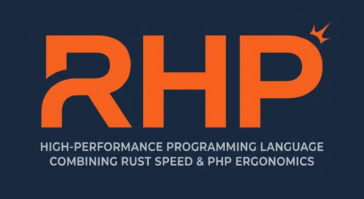

<p align="center">
  
</p>

# RHP

<p align="center">
  <a href="https://vuenice.github.io/rhp/"></a>
  <a href="https://discord.gg/DdCn4ySEv"></a>
  <a href="https://github.com/vuenice/rhp/actions"></a>
  <a href="https://github.com/vuenice/rhp/blob/main/LICENSE"></a>
</p>

> 📖 **Official Documentation:** Visit [**https://vuenice.github.io/rhp/**](https://vuenice.github.io/rhp/) for comprehensive guides, tutorials, syntax reference, and architecture deep dives.

---

## What is RHP?

**RHP** is a statically typed, compiled programming language built with the power and safety of **Rust** and the intuitive, developer-friendly syntax of **PHP**.

---

## What is the Goal?

* **Type Safety & Reliability:** Bring robust static typing and compiler guarantees to PHP applications, drastically reducing runtime bugs.
* **Clean Code & Built-in Tooling:** Enforce clean, standardized code through an inbuilt linter, type-checker, and auto-formatter.
* **First-Class AI Support:** All linting, compiler diagnostics, and runtime errors can be emitted in structured **JSON format**, enabling AI coding assistants to analyze issues and make accurate code corrections using fewer tokens.
* **High Concurrency Without Leaks:** While we do not make premature claims on speed today, in the very near future RHP will obtain **Swoole-like speed** without state and memory leaks across requests.

---

## What is RHPM?

**RHPM** is the runtime and process manager for RHP:
* Handles all incoming web requests.
* Provides native `Request` and `Response` helper classes.
* Manages a multi-process and multi-threaded architecture (similar to Swoole and PM2) for enhanced speed and high throughput.

---

## Is it for new applications?

**Yes.** If you are building a new application or a hobby project using AI coding tools, a type-safe language should be your first choice. 

On top of strict type safety, all linting, compilation, and runtime errors are provided in machine-readable JSON format, allowing AI models to make fast, accurate decisions with minimal token overhead.

If you ever get stuck or have questions, join our community on Discord: [**Join RHP Discord Server**](https://discord.gg/DdCn4ySEv).

---

## Can I migrate an existing PHP app to RHP?

**Yes.** You can migrate your existing PHP application to RHP with a single command:

```bash
rhp migrate
```

On top of automated syntax transformations, if you provide an API key to this command, it leverages AI to migrate your application with 100% accuracy.

> **⚠️ Alpha Notice:** RHP is currently in **Alpha**. We do not recommend deploying it to production yet, but we strongly encourage you to test it on your projects and share your feedback so we can continue improving the language, tooling, and compiler.

---

## ✨ Basic Syntax & Highlights

RHP keeps the intuitive syntax of PHP while introducing modern language ergonomics inspired by **JavaScript**, **Python**, and **Rust**.

### 1. Arrow Operator Directly on Variables (JS-style)
Call methods and transformations directly on primitives and variables without cumbersome function wrappers:

```php
// Chaining methods directly on strings
$text = "  hello world  ";
$clean = $text->trim()->upperCase(); // "HELLO WORLD"
$lower = $text->trim()->lowerCase(); // "hello world"
$slug = $text->trim()->slug();       // "hello-world"

// Casing transformations
$camel  = "hello_world"->camelCase();  // "helloWorld"
$pascal = "hello_world"->pascalCase(); // "HelloWorld"
$snake  = "helloWorld"->snakeCase();   // "hello_world"

// Chaining directly on collections
$numbers = [1, 2, 3, 4, 5];
$result = $numbers
    ->map(fn($n) => $n * 2)
    ->filter(fn($n) => $n > 4); // [6, 8, 10]
```

### 2. Modern Function Names (Python & JS-style)
Old PHP functions (like `strlen`, `str_replace`, `explode`, `array_map`, `strtolower`, `strtoupper`) are fully supported for backwards compatibility, but you will surely fall in love with clean, modern method names:

```php
// Python/JS-inspired array methods
$items = ["apple", "banana"];
$items->push("cherry");
$items->pop();
$joined = $items->join(", ");

// Intuitive string methods and casing
$str = "rhp_framework";
$hasPrefix = $str->startsWith("rhp"); // true
$parts = $str->split("_");            // ["rhp", "framework"]
$length = $str->len();                // 13 (or $str->length())
$upper = $str->upperCase();           // "RHP_FRAMEWORK"
$camel = $str->camelCase();           // "rhpFramework"
$pascal = $str->pascalCase();         // "RhpFramework"
```

### 3. Array Types: `list`, `dict`, `set`, `tuple`, and `hashMap` (Python-style)
Say goodbye to PHP's monolithic "everything-is-a-hash-table" array. RHP introduces dedicated, memory-efficient data types:

```php
// list: Sequential, 0-indexed integer array
list $users = ["Alice", "Bob", "Charlie"];

// dict: Key-value dictionary maintaining strict insertion order
dict $config = ["host" => "127.0.0.1", "port" => 8080];

// set: Unique values collection with O(1) membership checks
$tags = Arr::set(["php", "rust", "php"]); // Contains ["php", "rust"]

// tuple: Fixed-length heterogeneous sequence
$status = (200, "OK");

// hashMap: Universal key-value map for arbitrary keys
$map = Arr::hashMap([$key => $value]);
```

### 4. Helper Classes (Laravel-style)
Expressive, static class facades that wrap optimized Rust implementations:

```php
// Arr, Str, Http, Request, Response, Carbon, File, Json, Log
$token = Str::random(32);
$now = Carbon::now()->addDays(7);
$data = Json::decode($responseBody);

// Web requests & responses in RHPM
$name = Request::get('name', 'Guest');
return Response::json(["status" => "ok", "user" => $name]);

// Native HTTP client
$response = Http::get("https://api.github.com/zen");
```

### 5. Attributes & `Arr::from()` (Rust-style)
RHP adopts Rust's attribute syntax and ergonomic conversion patterns:

```php
// Rust-style Attributes for routing, injection, and metadata
#[Route('/api/orders', method: 'GET')]
#[Inject]
class OrderController {
    #[Cached(ttl: 3600)]
    public function getOrders(): Response {
        // ...
    }
}

// Arr::from() inspired by Rust's From / Into traits
// Seamlessly convert dictionaries, iterables, or sets into a list:
$dict = ['a' => 1, 'b' => 2];
list $fromDict = Arr::from($dict); // [1, 2]
```

---

## How to run?

You can run your code in development mode (instant AST execution with hot-reloading) or execute scripts directly:

```bash
# Run in Development Mode
rhp dev index.rhp

# Run a project directory (auto-launches web server if web handlers exist)
rhp dev examples/todo

# Run a single .rhp script directly
rhp ./script.rhp
```

---

## How to lint?

RHP includes an inbuilt linter and auto-formatter that infers and inserts types, enforces naming conventions, and formats braces and spacing:

```bash
# Auto-format, infer types, and lint the current directory
rhp lint .

# Check without writing changes to disk
rhp lint --check

# Output diagnostics in JSON format for AI assistants and CI
rhp check --format=json
```

---

## How to build / serve?

Compile into production bytecode VM with Cranelift JIT or serve web applications directly:

```bash
# Build and execute in Production Mode (Register VM bytecode + JIT)
rhp build index.rhp
rhp build examples/todo

# Start the built-in HTTP web server
rhp serve --port 8080

# Manage web services with the built-in RHPM process supervisor (PM2-style)
rhp start my-app --file=app.rhp --port=8080
rhp status
rhp logs my-app
rhp stop my-app
```

---

## How to report issues?

We appreciate bug reports, feature requests, and feedback:
* **GitHub Issues:** Open a ticket on [GitHub Issues](https://github.com/vuenice/rhp/issues) with reproduction steps and diagnostic logs.
* **Discord:** Ask questions and share feedback directly in our [Discord Server](https://discord.gg/DdCn4ySEv).

---

## How to Contribute?

Contributions to RHP are warmly welcomed!

1. **Fork & Clone:** Clone the repository locally:
   ```bash
   git clone https://github.com/vuenice/rhp.git
   cd rhp
   ```
2. **Build from Source:** Ensure you have Rust and Cargo installed:
   ```bash
   cargo build
   cargo test
   ```
3. **Pick an Area:** Contribute to the compiler, AST parser, type checker, register VM, standard facades (`Arr`, `Str`, `Http`), or the `rhp migrate` tool.
4. **Submit a Pull Request:** Open a PR against `main` describing your changes and tests.
5. **Join the Discussion:** Connect with maintainers on [Discord](https://discord.gg/DdCn4ySEv) or in GitHub Discussions.
