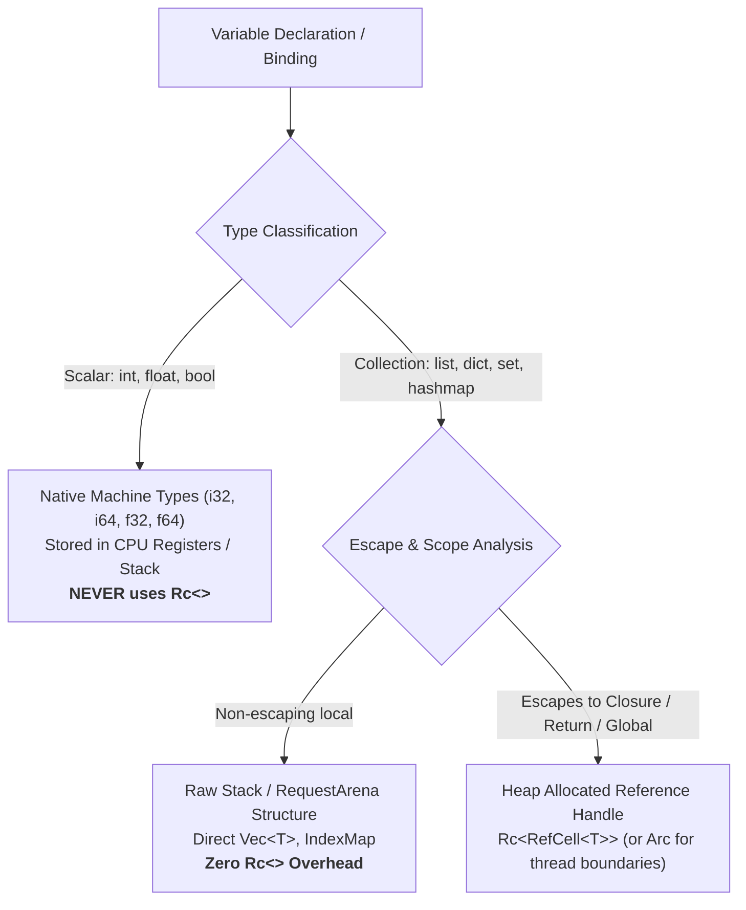
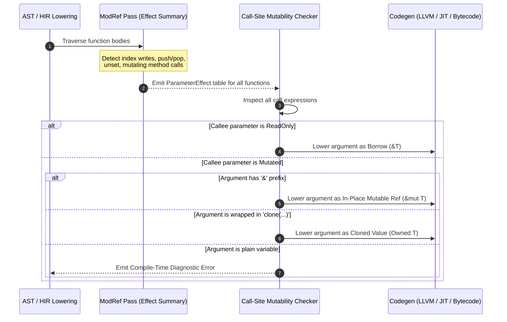

# Compiler Optimization Specification: Memory, Types & Explicit Collection Mutability

This document outlines the compiler analysis and optimization architecture for the RHP compiler pipeline. It details the strategy for native type assignment, `Rc<>` minimization, side-effect and escape analyses, and the **explicit mutability contract** for collection parameters.

---

## 1. Core Architectural Philosophy

Traditional dynamic languages (such as standard PHP) rely on silent, runtime **Copy-on-Write (COW)** semantics and ubiquitous reference-counting wrappers (`zval`, `Rc<RefCell<...>>`). While convenient, this approach incurs substantial hidden runtime penalties:
- Constant reference-count bumps and checks on function calls.
- Unpredictable deep buffer copies triggered lazily on writes.
- Cache thrashing due to multi-layer pointer indirection.

RHP establishes a **performance-first paradigm** driven by compile-time static analysis and **explicit developer contracts**:
1. **Zero-cost primitives:** Primitives (`int`, `float`, `bool`) remain unboxed in CPU registers or on the stack with zero `Rc<>` overhead.
2. **Strict escape & lifetime tracking:** `Rc<>` is reserved exclusively for values whose lifetimes escape their stack frames and are genuinely co-owned.
3. **Explicit Mutability at Function Boundaries:** The compiler forbids implicit collection copying. If a function mutates an array, the developer must explicitly state whether to pass by reference (`&$arr`) or create an isolated copy (`clone($arr)`).

---

## 2. Variable Classification & Memory Representation



### 2.1 Why `int` and `float` Never Need `Rc<>`
1. **Hardware Fit:** Primitives (32-bit `i32`/`f32` or 64-bit `i64`/`f64`) fit directly into CPU general-purpose and SIMD registers (`rax`, `xmm0`).
2. **Allocation Overhead:** An `Rc<T>` adds 8 bytes for the heap pointer, plus 16 bytes for the strong and weak counters, plus heap allocator metadata. Boxing a 4-byte `int` into an `Rc<i32>` introduces **5–8x memory overhead** and an avoidable pointer dereference cache miss.
3. **Copy vs Refcount Costs:** Copying a primitive is a single CPU instruction (`mov %rax, %rbx`). Incrementing and decrementing an `Rc` involves reading, modifying, and storing counter memory.
4. **The Only Edge Case (Escaping Mutable Closures):**
   The only condition where a scalar requires heap indirection is when an inner closure captures a local variable *by reference* and outlives the creating function frame:
   ```php
   function createCounter(): callable {
       int $count = 0;
       return function() use (&$count) { // $count outlives createCounter()
           $count++;
           return $count;
       };
   }
   ```
   In this scenario, the compiler lifts `$count` into an escaping upvalue cell (`Rc<RefCell<i32>>`). In all other situations, scalars are raw, unboxed values.

### 2.2 Side-Effect Freedom & Pure Local Variables
Through **Purity Analysis** and **Use-Def Chains**:
- Variables that are pure and side-effect free (not subject to external mutation or I/O) are mapped to **SSA virtual registers**.
- They undergo **Constant Folding**, **Dead Code Elimination (DCE)**, and **Common Subexpression Elimination (CSE)**.
- Local collections that never escape their defining scope are allocated in the high-speed `RequestArena` or directly on the stack without heap allocation headers.

### 2.3 Direct Native Transformation in `dev` and `build` Commands

Both Development Mode (`rhp dev` / `rhp run dev`) and Production / Build Mode (`rhp build` / `rhp run build`) enforce direct native transformations for primitive types with **zero `Rc<>` heap overhead**:

| RHP Type | Direct Transformation | Target Rust Structure | Memory Overhead | `Rc<>` Requirement |
| :--- | :--- | :--- | :--- | :--- |
| **`int` / `Int`** | Direct `i32` | Native 32-bit integer register / stack word | 4 bytes (zero pointer) | **None (`requires_rc() == false`)** |
| **`float` / `Float`** | Direct `f32` | Native 32-bit IEEE-754 SIMD / stack word | 4 bytes (zero pointer) | **None (`requires_rc() == false`)** |
| **`bool` / `Bool`** | Direct `bool` | Native boolean byte / flag | 1 byte (zero pointer) | **None (`requires_rc() == false`)** |
| **`null` / `Null`** | Direct `None` | `Option<T>::None` / unboxed sentinel | 0 bytes | **None (`requires_rc() == false`)** |

- **Development Mode (`RunMode::Dev` / `rhp dev`):**
  - AST evaluator (`eval_expr`) directly operates on `i32` integers and `f32` floats.
  - Functional conversions (`int($x)`, `float($x)`, `bool($x)`) evaluate directly in-place without generating intermediate heap cells or allocating constant pools.
  - `null` directly yields `PhpValue::Null`, which seamlessly maps to/from Rust's `None` (`.as_none()`, `.into_option()`, `From<Option<T>>`).

- **Production / Build Mode (`RunMode::Build` / `rhp build`):**
  - IR lowering emits dedicated inline opcodes:
    - `OpCode::LoadInt { dst, value: i32 }`
    - `OpCode::LoadFloat { dst, bits: u32 }` (raw IEEE-754 `f32` bits, zero constant-pool lookup)
    - `OpCode::LoadBool { dst, value: bool }`
    - `OpCode::LoadNull { dst }`
  - Eliminates constant-pool indirection for floats and ints.
  - Registers store unboxed values in CPU registers / native slots without reference counting (`ref_count() == 1`, `is_shared() == false`).

---

## 3. Explicit Collection Mutability Contract

Rather than hiding deep array copies behind implicit runtime COW or guessing developer intent, the compiler enforces an **Explicit Mutability Contract** at compile time for all collection types (`array`, `list`, `dict`, `set`, `hashmap`).

### 3.1 The Developer-Facing Rules

| Callee Behavior | Developer Calling Syntax | Compiler Action | Runtime Behavior |
| :--- | :--- | :--- | :--- |
| **Callee does NOT edit** | `foo($my_array)` | **Allowed** | Passes by immutable borrow (`&[T]`). Zero copy, zero RC bump. |
| **Callee EDITS** | `foo($my_array)` | ❌ **Compile-Time Error** | Compilation halts. Explains that `$my_array` is mutated and requires explicit intent. |
| **Callee EDITS** | `foo(&$my_array)` | **Allowed** | Passes mutable reference (`&mut T`). In-place mutation of caller's array. |
| **Callee EDITS** | `foo(clone($my_array))` | **Allowed** | Eagerly clones buffer once. Callee mutates its isolated clone; caller remains untouched. |

---

### 3.2 Code Examples & Compiler Diagnostics

#### Case 1: Read-Only Parameter (Valid)
```php
function printSummary(list $items) {
    echo "Count: " . count($items);
    echo "First: " . $items[0];
    // No modifications made to $items
}

function run() {
    list $data = [10, 20, 30];
    printSummary($data); // ✅ Valid: Compiler passes borrowed &data (zero copy)
}
```

#### Case 2: Implicit Mutation Attempt (Compile Error)
```php
function appendMarker(list $items) {
    $items[] = 999; // Mutates $items!
}

function run() {
    list $data = [1, 2, 3];
    
    appendMarker($data); 
    // ❌ COMPILE-TIME ERROR:
    // Error: Implicit copy disallowed. Parameter '$items' is modified in function 'appendMarker'.
    //
    // Help: Choose one of the following explicit calling conventions:
    //   1. Pass by reference to modify in-place:
    //      appendMarker(&$data);
    //   2. Pass an explicit copy if you want the caller to retain original data:
    //      appendMarker(clone($data));
}
```

#### Case 3: Explicit In-Place Mutation via Reference (Valid)
```php
function appendMarker(list &$items) {
    $items[] = 999;
}

function run() {
    list $data = [1, 2, 3];
    appendMarker(&$data); // ✅ Valid: Zero copy, modifies $data directly in-place
}
```

#### Case 4: Explicit Clone (Valid)
```php
function appendMarker(list $items) {
    $items[] = 999;
}

function run() {
    list $data = [1, 2, 3];
    appendMarker(clone($data)); // ✅ Valid: Explicit clone, caller retains [1, 2, 3]
}
```

---

## 4. Compiler Analysis Pipeline & Architecture

To implement this contract, the compiler introduces three cooperating passes during lowering:



### 4.1 Pass 1: Parameter ModRef Analysis
The compiler walks every function body in the AST/HIR and builds a `ParamEffectSummary`:

```rust
#[derive(Debug, Clone, Copy, PartialEq, Eq)]
pub enum ParamEffect {
    /// Parameter is only read (indexed, iterated, queried for length).
    ReadOnly,
    /// Parameter is mutated (assigned into, pushed/popped, unset, or passed to another mutating function).
    Mutated,
    /// Parameter escapes to an external storage or closure.
    Escaped,
    /// Parameter is passed to an indirect/dynamic invocation and cannot be statically proven.
    Unknown,
}

pub struct FunctionEffectSummary {
    pub param_effects: Vec<(String, ParamEffect)>,
}
```

#### Mutation Triggers:
A parameter is tagged `Mutated` if any of the following occur:
1. **Direct Index Assignment:** `$param[$key] = $val;` or `$param[] = $val;`
2. **Unset Operations:** `unset($param[$key]);`
3. **Mutating Standard Functions & Facades:** `Arr::sort($param);`, `array_push($param, ...)`.
4. **Mutating Method Calls:** `$param->push(...)`, `$param->set(...)`, `$param->clear()`.
5. **Transitive Mutating Calls:** Passed as an argument to another function where that parameter is marked `Mutated`.

### 4.2 Pass 2: Call-Site Semantic Enforcement
When checking function calls `CallExpr(callee, args)`:
1. Lookup the callee's `FunctionEffectSummary`.
2. For each argument passed to a parameter marked `Mutated`:
   - If argument is an AST node `RefExpr(&$var)`: verified as explicit pass-by-reference.
   - If argument is an AST node `CloneExpr(clone($var))`: verified as explicit clone.
   - If argument is a plain variable `$var`:
     - **Raise compile error** with diagnostic span and quick-fix recommendations.

### 4.3 Pass 3: Codegen & Machine Lowering
When lowering to native machine code or bytecode:
- **`ReadOnly` Parameters:** Codegen emits a direct borrowed slice or pointer (`&[PhpValue]` or `&Vec<PhpValue>`).
  - No heap allocation.
  - No `Rc::clone()`.
  - No atomic operations.
- **`&$param` (Reference):** Codegen emits a mutable pointer (`&mut Vec<PhpValue>`).
  - Directly mutates the caller's allocation in-place.
- **`clone($param)` (Clone):** Codegen emits a single explicit deep clone before passing ownership into the callee.

---

## 5. Edge Cases & Advanced Scenarios

### 5.1 Dynamic and Indirect Calls
If a call is indirect (e.g. `$func($arr)` where `$func` is a variable or dynamic callable):
- The compiler cannot statically inspect the callee's body.
- **Strict Mode:** Disallow passing plain collections to dynamic callables; require `clone($arr)` or explicit reference.
- **Permissive Mode:** Emit a runtime Copy-on-Write guard that logs a warning or clones if a write occurs.

### 5.2 Recursion & Mutual Calls
- Mutual recursion (`foo()` calls `bar()` which calls `foo()`):
- Implemented via standard **Karr's fixed-point iteration**:
  1. Initialize all collection parameters as `ReadOnly`.
  2. Iteratively inspect call graphs until all parameter states converge.
  3. If a cycle involves a mutation, all parameters along that path escalate to `Mutated`.

### 5.3 Aliasing in Multi-Argument Calls
If a caller passes the same variable to multiple parameters:
```php
foo(&$data, $data);
```
The compiler's alias detector flags this as a compile error (analogous to Rust's aliasing XOR mutability rule), preventing undefined behavior where a mutable reference and an immutable borrow point to the same memory simultaneously.

---

## 6. Implementation Roadmap

1. **Milestone 1: Parser & AST Support**
   - Verify parser support for prefix `&` in call arguments (`foo(&$arr)`).
   - Ensure `clone(...)` expressions are cleanly tagged in the AST.

2. **Milestone 2: ModRef Effect Analysis Pass**
   - Implement the AST visitor in `src/type_system/` or `src/ir/` that computes `ParamEffect` for all declared functions.
   - Generate summary metadata attached to `FunctionDeclaration`.

3. **Milestone 3: Diagnostic Lint / Type Checker Enforcement**
   - Add compiler pass verifying call-site arguments against `ParamEffect`.
   - Implement rich diagnostics with span highlighting and actionable suggestions.

4. **Milestone 4: Codegen & IR Lowering Optimization**
   - Specialize function signatures in IR: emit borrowed reference arguments for `ReadOnly` parameters.
   - Eliminate redundant `Rc` wraps and COW checks for provably borrowed collection arguments.
