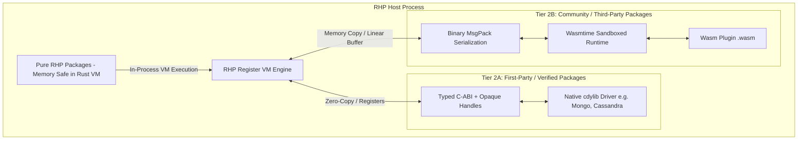

# RFC-001: RHP Unified Package Specification (Pure RHP & Native Rust Extensions)

- **Status:** Draft / Proposed
- **Author:** RHP Core Team & Community
- **Target Version:** RHP 0.8+
- **Area:** Package System, Module Resolution, Native Plugins (Tier 2), Sandboxing, Security & Tooling (`rhpm`)

---

## 1. Executive Summary & Problem Statement

RHP requires a unified package architecture capable of balancing **maximum native throughput** for critical drivers with **strict security, sandboxing, and crash isolation** for third-party libraries:

1. **Pure RHP Packages:** High-level frameworks, HTTP routers, ORMs, utility classes, and compile-time macro handlers written entirely in RHP syntax with deterministic, zero-bootstrap PSR-4 autoloading.
2. **First-Party / Verified Native Packages (Tier 2A):** High-throughput infrastructure drivers (e.g., MongoDB, Apache Cassandra, Azure Cosmos DB, Kafka, Redis, low-level JWT cryptography) compiled as native dynamic libraries (`cdylib` / `.so`) with direct **Typed C-ABI and Opaque Handles** for maximum execution speed and persistent connection pooling.
3. **Community / Third-Party Native Packages (Tier 2B):** Sandboxed WebAssembly (Wasm / WASI via `wasmtime`) utilizing **Binary Serialization (MessagePack / CBOR)** for cross-platform portability, zero-crash containment, and safe execution.
4. **Safety & Capability Declaration:** Explicit safety classification in `rhp.toml` (`safety = "safe"` vs `safety = "unsafe"` / fine-grained capabilities) to declare whether a package is permitted to perform outbound network/HTTP requests (e.g. Sentry, payment gateways) or is restricted to pure local computation.

---

## 2. Package Manifest Specification (`rhp.toml`)

Every RHP package must declare its metadata, type, execution target, and security capabilities in `rhp.toml`.

```toml
[package]
name = "vendor/package-name"
version = "1.0.0"
authors = ["Jane Doe <jane@example.com>"]
license = "MIT"
description = "High performance RHP package"
type = "rhp" # "rhp" | "native-rust" | "wasm" | "hybrid"
rhp-version = ">=0.8.0"

# Security & Network Capabilities
safety = "safe" # "safe" (no network egress) | "unsafe" (requires network/side-effects)

# Optional fine-grained capability restrictions
[capabilities]
network = []              # e.g., ["api.sentry.io:443", "https"]
filesystem = []           # e.g., ["read:/tmp"]
env = []                  # e.g., ["SENTRY_DSN"]

# Pure RHP autoloading configuration
[autoload]
psr-4 = { "Vendor\\Package\\" = "src/" }
files = ["src/helpers.rhp"]

# Exports configuration (Public API boundaries)
[exports]
facades = ["Cache", "Mongo"]
namespaces = ["Vendor\\Package"]

# Required only for type = "native-rust", "wasm", or "hybrid"
[native]
crate-name = "rhp_mongo"
target-dir = "crates/mongo"
abi-version = 1
entry-symbol = "rhp_plugin_init"
thread-safe = true
execution-target = "native" # "native" (verified only) | "wasm" (default for untrusted)
marshalling = "typed-c-abi" # "typed-c-abi" (verified) | "msgpack" (wasm/untrusted)

# Dependencies
[dependencies]
"vendor/core-utils" = "^1.2"

# Dev dependencies
[dev-dependencies]
"rhp/test" = "^1.0"
```

---

## 3. Package Safety & Capability Model (`safe` vs `unsafe`)

Modern supply-chain attacks frequently occur when utilities or math libraries make unauthorized outbound HTTP requests to exfiltrate secrets or environment variables.

RHP introduces an explicit safety model in `rhp.toml`:

```
┌────────────────────────────────────────────────────────────────────────┐
│                        RHP SECURITY MODEL                              │
├──────────────────────────────────┬─────────────────────────────────────┤
│        `safety = "safe"`         │        `safety = "unsafe"`          │
├──────────────────────────────────┼─────────────────────────────────────┤
│ - Strictly pure computation      │ - Permitted to perform network I/O  │
│ - Zero outbound HTTP requests    │ - Must declare network endpoints    │
│ - Zero raw socket access         │ - Examples: Sentry, Stripe, Twilio  │
│ - Examples: Parsers, Math, JWT   │ - Audited during `rhp install`      │
└──────────────────────────────────┴─────────────────────────────────────┘
```

### 3.1 Verification & Enforcement
1. **Compile-Time Static Audit (`rhp audit` / `rhp build`):**
   - The compiler inspects the AST of all packages marked `safety = "safe"`.
   - Any invocation of `Http::*`, `Socket::*`, `cURL`, or native network FFI inside a `safe` package halts compilation with a fatal `SecurityViolationError`.
2. **Runtime Sandbox Enforcement:**
   - **For Wasm packages:** The `wasmtime` runtime physically restricts WASI socket capabilities. If an unprivileged package calls `connect()`, the OS call is trapped and rejected.
   - **For Pure RHP packages:** The VM execution fiber checks the caller's package capability context before dispatching network I/O.
   - **For Verified Native packages:** Reviewed and cryptographically signed before being granted `native` execution access.

---

## 4. Dual Native Execution & Memory Isolation Architecture



### 4.1 Do Packages Share Common Memory and Crash the Main Process?

| Package Category | Execution Engine | Memory Space | Can It Crash the Main Process? |
| :--- | :--- | :--- | :--- |
| **Pure RHP Packages** (`type = "rhp"`) | RHP Rust VM / Fibers | Managed safe memory inside RHP VM | **NO.** Exceptions and panics are trapped. Invalid indexes throw RHP Exceptions, never segfaults. |
| **Verified Native** (`type = "native-rust"`) | In-process `.so` / `.dylib` via `libloading` | Shared process address space | **YES, if buggy.** Panics are caught via `catch_unwind`, but raw C-level segfaults can terminate the process. (Reserved strictly for vetted, first-party drivers). |
| **Wasm Community** (`type = "wasm"`) | Isolated `wasmtime` virtual machine | Isolated linear memory per module | **NO.** Wasm crashes trap cleanly inside Wasmtime; the host process and other worker threads continue running. |

---

## 5. Dual Value Marshalling Protocol

RHP pairs the execution model directly with the appropriate data-marshalling strategy:

### 5.1 Tier 2A: Typed C-ABI + Opaque Handles (Verified Native Packages)
*Optimized for extreme throughput, zero serialization, and multi-gigabyte queries.*

1. **Primitive Passing in CPU Registers:**
   Integers, floats, booleans, and null pass through registers (`i64`, `f64`) using `RhpRawValue`.
2. **Opaque Handles for Connection Pools:**
   Database connections (`Client`, `Session`, `Cursor`) remain inside native Rust memory. The RHP runtime only holds an integer handle (`u64` ID).
   ```php
   $client = Mongo::connect("mongodb://localhost"); // Returns OpaqueHandle
   $cursor = Mongo::query($client, "users", ["active" => true]); // Passes handle
   ```
3. **Zero-Copy Native Arenas:**
   Results can be written directly into RHP’s internal associative array arenas without intermediate JSON or string copies.

### 5.2 Tier 2B: Binary Serialization (MessagePack / CBOR) (Wasm Community Packages)
*Optimized for safety, schema stability, and memory-boundary crossing.*

1. **Memory Isolation:**
   Wasm runs within its own linear memory block. Data must cross the boundary regardless; direct pointers cannot be dereferenced by the host.
2. **Packed Binary Frames:**
   Arguments and return values are serialized into compact MessagePack or CBOR binary streams.
3. **No Pointer Vulnerabilities:**
   Malicious or malformed plugins cannot forge host memory pointers, eliminating memory disclosure and arbitrary code execution vectors.

---

## 6. Practical Manifest Examples

### 6.1 Verified First-Party MongoDB Driver (`rhp.toml`)
```toml
[package]
name = "rhp/mongo"
version = "2.1.0"
type = "native-rust"
safety = "unsafe" # Permitted to perform network I/O to database clusters

[capabilities]
network = ["*"] # Database driver connects to dynamic host strings

[native]
crate-name = "rhp_mongo"
target-dir = "crates/mongo"
execution-target = "native"
marshalling = "typed-c-abi"
abi-version = 1
```

### 6.2 Third-Party Sentry Error Reporter (`rhp.toml`)
```toml
[package]
name = "community/sentry"
version = "1.0.4"
type = "wasm"
safety = "unsafe" # Outbound telemetry requests

[capabilities]
network = ["*.ingest.sentry.io:443"] # Restricted solely to Sentry ingest endpoints

[native]
execution-target = "wasm"
marshalling = "msgpack"
```

### 6.3 Pure RHP Safe Collection Package (`rhp.toml`)
```toml
[package]
name = "illuminate/collections"
version = "11.0.0"
type = "rhp"
safety = "safe" # Pure computation; any network call is rejected by compiler

[autoload]
psr-4 = { "Illuminate\\Support\\" = "src/" }
```

---

## 7. Tooling & Security Workflow

```bash
# 1. Audit all dependencies for safety declarations
rhp audit

# 2. Compile package with automatic target selection
rhp package build

# 3. Verify native plugin checksum against official RHP trust registry
rhp plugin verify rhp/mongo
```

---

## 8. Summary of Guarantees

1. **Maximum Speed where it counts:** MongoDB, Cassandra, Cosmos DB, and Redis run at 100% native machine speed via `cdylib` and Typed C-ABI.
2. **Zero Process Crashes from Community Code:** Untrusted packages run in Wasm with MessagePack boundaries; an unhandled error traps safely without taking down the server.
3. **Supply-Chain Security:** Packages must declare their `safety` status. Pure computational packages (`safe`) are physically prevented from making outbound HTTP requests.
