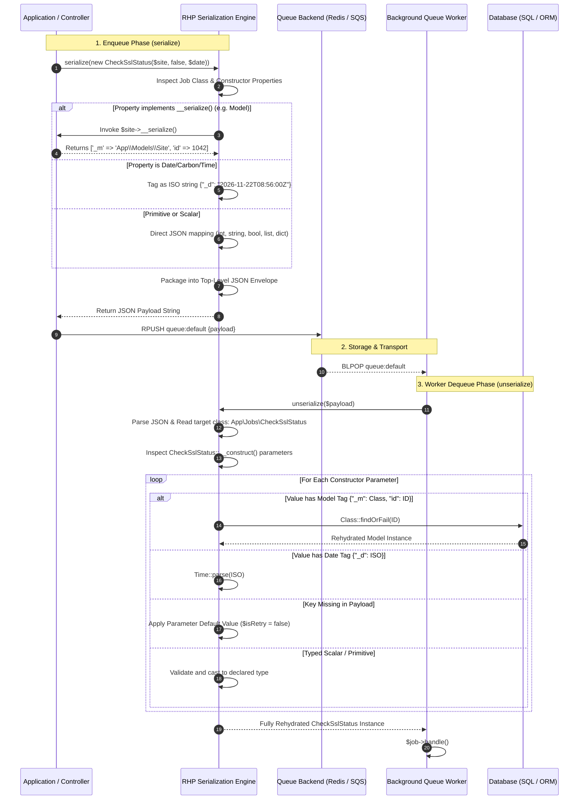

# Serialization & Job Queues

RHP provides a modern, secure, and transparent serialization architecture designed to replace PHP's legacy binary `serialize()` / `unserialize()`. 

Unlike standard PHP—which is notorious for Object Injection vulnerabilities, arbitrary POP gadget execution, and opaque binary strings—RHP treats serialized state as **structured, typed JSON envelopes** with explicit separation between **language-level primitives** and **framework-level entity lifecycle**.

---

## Core Philosophy: Division of Responsibility

A major flaw in traditional runtime design is attempting to solve database entity hydration inside the language engine. In RHP, responsibilities are cleanly divided:

```
┌────────────────────────────────────────────────────────────────────────┐
│                        Framework Layer (Laravel)                       │
│  • Database Models & Querying (Site::findOrFail($id))                  │
│  • Collection rehydration (whereIn('id', $ids))                        │
│  • Multi-database connection tracking                                  │
└───────────────────────────────────┬────────────────────────────────────┘
                                    │ implements __serialize() / __unserialize()
┌───────────────────────────────────▼────────────────────────────────────┐
│                       Language Core Engine (RHP)                       │
│  • Clean JSON envelope encoding & decoding                             │
│  • Built-in primitive casting (int, float, string, bool, list, dict)   │
│  • Native Date tagging: {"_d": "ISO"} ➔ Time::parse()                 │
│  • Parameter default fallback ($b = false) and nullable resolution     │
│  • Rejection of closures, active handles, and non-serializable traits  │
└────────────────────────────────────────────────────────────────────────┘
```

1. **The Language Engine (RHP):** Serializes primitives, dates, and object graphs into predictable JSON envelopes. On deserialization, it matches constructor parameters, resolves dates, and fills in constructor default values for absent keys.
2. **The Framework Layer (Laravel / ORM):** Defines how database entities represent themselves. The framework reduces a complex `Model` to an identifier `{ "_m": "User", "id": 1042 }` during serialization, and restores it via `User::findOrFail(1042)` upon execution.

---

## Complete End-to-End Flow Graph

The following diagram illustrates the complete lifecycle of a queued job from dispatch through queue storage to worker execution:



---

## Wire Format: The JSON Envelope

When `serialize($job)` is called, RHP outputs a human-readable, debuggable JSON envelope instead of an opaque binary blob:

```json
{
  "__class": "App\\Jobs\\CheckSslStatus",
  "__data": {
    "site": {
      "_m": "App\\Models\\Site",
      "id": 1042,
      "connection": "mysql"
    },
    "isRetry": false,
    "scheduledAt": {
      "_d": "2026-11-22T08:56:00Z"
    }
  }
}
```

### Wire Type Tags

| Tag | Format | Purpose | Resolution on Deserialization |
| :--- | :--- | :--- | :--- |
| `_m` | `{"_m": "Class", "id": N}` | Framework Database Model | Calls `Class::findOrFail(N)` |
| `_m_coll` | `{"_m_coll": "Class", "ids": [...]}` | Model Collection | Calls `Class::whereIn('id', ids)->get()` |
| `_d` | `{"_d": "ISO-8601"}` | Date / Timestamp | Rehydrated via `Time::parse($iso)` |
| `Primitives` | `int`, `float`, `string`, `bool` | Native Scalars | Cast and range-checked against parameter types |
| `Collections` | `list`, `dict` | Native Arrays | Mapped to `PhpValue::List` or `PhpValue::Dict` |

---

## Zero Changes for Laravel Applications

Application jobs in Laravel or RHP use standard PHP syntax. **No custom decorators, macros, or code rewrites are required.**

### Standard Job Declaration
```php
namespace App\Jobs;

use App\Models\Site;
use Carbon\Carbon;
use Illuminate\Contracts\Queue\ShouldQueue;
use Illuminate\Queue\SerializesModels;

class CheckSslStatus implements ShouldQueue
{
    use SerializesModels;

    /**
     * Constructor parameters automatically define the serialized schema.
     */
    public function __construct(
        public Site $site,
        public bool $isRetry = false,
        public ?Carbon $scheduledAt = null,
    ) {}

    public function handle(): void
    {
        // $this->site is guaranteed to be fully rehydrated from the database
        $this->site->updateSslCertificate();
    }
}
```

### Framework Model Trait (`SerializesModels`)

At the framework layer, the `SerializesModels` trait implements the standard `__serialize()` and `__unserialize()` hooks:

```php
namespace Illuminate\Queue;

trait SerializesModels
{
    /**
     * Reduce the model to an entity reference before serialization.
     */
    public function __serialize(): array
    {
        return [
            '_m' => static::class,
            'id' => $this->getKey(),
            'connection' => $this->getConnectionName(),
        ];
    }

    /**
     * Restore model state from database identifier.
     */
    public function __unserialize(array $data): void
    {
        $class = $data['_m'];
        $connection = $data['connection'] ?? null;
        
        $model = $class::on($connection)->findOrFail($data['id']);
        
        $this->setRawAttributes($model->getAttributes());
        $this->setConnection($connection);
    }
}
```

---

## Rolling Deploys & Schema Evolution

In production systems, rolling deployments mean workers running code version $N+1$ frequently process jobs enqueued by deploy $N$ (or vice versa).

RHP handles schema evolution gracefully without requiring manual version numbers (`#[version(2)]`):

### 1. Parameter Default Values
When a new parameter is added to a job:
```php
public function __construct(
    public Site $site,
    public bool $isRetry = false,
    public string $priority = "normal", // Added in new deploy
) {}
```
If an in-flight job payload created by an older worker arrives without the `"priority"` key, RHP automatically inspects the constructor signature and supplies `"normal"`.

### 2. Tolerant Decoding of Unknown Fields
If a newer worker enqueues a job containing new fields, and an older worker picks it up before restarting, RHP ignores unmapped JSON keys rather than crashing, ensuring backward and forward rolling deploy safety.

---

## Safety Guarantees & Eliminated Vulnerabilities

| Problem Area | Legacy PHP (`serialize`) | BullMQ / Node.js | RHP Architecture |
| :--- | :--- | :--- | :--- |
| **Object Injection / RCE** | ⚠️ **Critical Risk:** Arbitrary gadget chains via `__wakeup` / `__destruct` | 🛡️ None (plain JSON) | 🛡️ **Zero Risk:** Strict constructor reflection; no uncontrolled destructors executed |
| **Circular References** | Requires pointer tables (`r:1;`) | ❌ Throws `TypeError` or crashes | 🛡️ **Eliminated:** Flat job commands and model IDs eliminate cyclic graphs |
| **Closure Leaks** | Often serialized via fragile AST reflection | ❌ Not supported | 🛡️ **Compile Error:** Closures are strictly forbidden in serializable positions |
| **Date Roundtrips** | Deserialized as raw object or string | ❌ Becomes plain string | 🛡️ **Preserved:** Native `{"_d": ISO}` auto-parsed to `Time` |
| **Transient Services** | Accidentally serializes injected services & DB pools | ❌ Method references lost | 🛡️ **Protected:** Only constructor properties are encoded; injected services are ignored |

---

## Standard Library API Reference

### `serialize(mixed $value): string`
Encodes any scalar, array, or serializable class instance into an RHP JSON envelope string.
```php
$json = serialize($job);
```

### `unserialize(string $payload): mixed`
Reconstructs the object instance, re-fetching models via framework hooks, parsing dates, and applying default parameters.
```php
$job = unserialize($json);
$job->handle();
```
