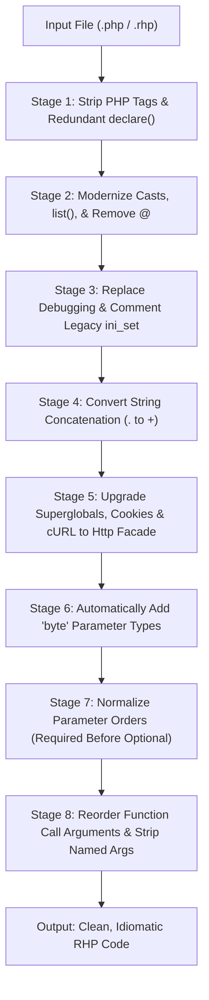

## Overview

The `rhp migrate` command provides an automated, AST-guided migration pipeline that transforms legacy PHP codebases into modern, high-performance RHP syntax:

```bash
rhp migrate [PATH] [OPTIONS]
```

RHP is engineered for extreme throughput, zero-garbage-collection request execution, pre-forked worker concurrency, and strict static typing. To achieve these guarantees, RHP eliminates legacy PHP dynamic quirks—such as runtime error suppression (`@`), untyped casts, procedural cURL boilerplate, superglobal mutations, and ambiguous argument semantics.

The `rhp migrate` tool automates these transformations safely while preserving formatting, docblocks, and business logic.

---

## Command-Line Usage and Options

```bash
# Migrate all PHP/RHP files in the current working directory
rhp migrate

# Migrate a specific directory or file
rhp migrate src/
rhp migrate app/Services/PaymentService.php

# Dry-run check: inspect changes without writing to disk
rhp migrate src/ --check
# or
rhp migrate src/ --dry-run

# Output results in machine-readable JSON format (ideal for CI/CD)
rhp migrate src/ --format=json

# Human-readable summary output (default)
rhp migrate src/ --format=human
```

### Options Reference

| Flag | Shorthand | Description | Default |
| :--- | :--- | :--- | :--- |
| `PATH` | | Target file or directory to migrate | `.` (current directory) |
| `--check` | `--dry-run` | Inspects code and reports changes without writing modifications to disk | `false` |
| `--format` | | Output format: `human` or `json` | `human` |
| `--help` | `-h` | Display help and usage details | |

---

## Automated Migration Pipeline

When invoked, `rhp migrate` analyzes target files and applies an 8-stage transformation pipeline:



---

## Migration Features Catalog

### 1. PHP Tag Stripping (`<?php` and `?>`)

In RHP, scripts and modules are first-class source files; inline HTML embedding and opening/closing PHP tags are not required.

```php
// BEFORE:
<?php
namespace App\Services;

class OrderProcessor {
    // ...
}
?>

// AFTER:
namespace App\Services;

class OrderProcessor {
    // ...
}
```

- Leading `<?php\n` and trailing `?>` tags are cleanly removed.
- Inline whitespace and shebang lines are preserved.

---

### 2. Redundant `declare(...)` Directive Stripping

RHP enforces strict scalar typing natively across all files at compile time. Runtime ticks and legacy file encoding directives are obsolete.

```php
// BEFORE:
declare(strict_types=1);
declare(ticks=1);
declare(encoding='UTF-8');

function add(int $a, int $b): int {
    return $a + $b;
}

// AFTER:
function add(int $a, int $b): int {
    return $a + $b;
}
```

- Strips `declare(strict_types=1);` and `declare(strict_types=0);`.
- Strips `declare(ticks=1);` and `declare(encoding=...);`.

---

### `foreach` to `for-in`

Legacy `foreach ($items as $value)` and `foreach ($items as $key => $value)` are rewritten to for-in. The iterable and the binding stay as written, including a destructuring pattern.

```php
// BEFORE:
foreach ($users as $name) {
    echo $name;
}
foreach ($users as $index => $name) {
    echo $name;
}

// AFTER:
for ($name in $users) {
    echo $name;
}
for ($index => $name in $users) {
    echo $name;
}
```

`foreach` inside a string or a comment is left unchanged. A C-style `for (init; cond; step)` is not rewritten. Compiling that header reports warning RHP0403. See [Control Flow](/docs/guide/control-flow).

---

### 3. Legacy `error_reporting(...)` Call Removal

RHP replaces runtime error masking with static diagnostics and compile-time boundary checks. Masking errors dynamically with `error_reporting()` is rejected.

```php
// BEFORE:
error_reporting(E_ALL);
error_reporting(0);

// AFTER:
// (Statements removed entirely)
```

---

### 4. Legacy `ini_set(...)` Call Commenting

Runtime configuration in RHP is managed via `rhp.toml` rather than per-request mutable runtime settings. Calls to `ini_set()` are safely commented out for auditability.

```php
// BEFORE:
ini_set('memory_limit', '512M');
ini_set('display_errors', '0');

// AFTER:
// ini_set('memory_limit', '512M');
// ini_set('display_errors', '0');
```

---

### 5. Functional Type Cast Conversion

PHP's C-style parenthesized type casts are converted to RHP's modern functional casting syntax.

```php
// BEFORE:
$id = (int)$_GET['id'];
$ratio = (float)$rate;
$name = (string)$buffer;
$flag = (bool)$active;
$raw = (binary)$stream;

// Aliases:
$num = (integer)$count;
$d = (double)$pi;
$r = (real)$val;
$b = (boolean)$status;

// AFTER:
$id = int(Request::query('id'));
$ratio = float($rate);
$name = string($buffer);
$flag = bool($active);
$raw = byte($stream);

// Aliases:
$num = int($count);
$d = float($pi);
$r = float($val);
$b = bool($status);
```

- Legacy PHP aliases `(integer)`, `(double)`, `(real)`, and `(boolean)` are mapped directly to canonical RHP types (`int`, `float`, `bool`).
- `(binary)` is converted to RHP's high-performance `byte(...)` primitive.

---

### 6. Modern Array Destructuring (`list(...)` to `[...]`)

Legacy `list(...)` constructs are updated to modern square-bracket destructuring syntax across variable assignments, keyed mappings, nested structures, and `foreach` loops.

```php
// BEFORE:
list($first, $second) = $pair;
list('id' => $id, 'title' => $title) = $record;
list($a, list($b, $c)) = $nested;
list($start, , $end) = $range;

foreach ($users as list($id, $username)) {
    // ...
}

// AFTER:
[$first, $second] = $pair;
['id' => $id, 'title' => $title] = $record;
[$a, [$b, $c]] = $nested;
[$start, , $end] = $range;

foreach ($users as [$id, $username]) {
    // ...
}
```

- Fully supports keyed destructuring (`list('k' => $v)` $\rightarrow$ `['k' => $v]`).
- Supports skipped elements with comma spacing (`list($a, , $c)` $\rightarrow$ `[$a, , $c]`).
- Preserves nested destructuring expressions.

---

### 7. Error Suppression Operator (`@`) Removal

Silent error suppression via the `@` operator hides bugs, hurts VM performance, and is deprecated in RHP.

```php
// BEFORE:
@unlink($temporaryFilePath);
$val = @$settings['nonexistent'];
@rmdir($dir);

// AFTER:
unlink($temporaryFilePath);
$val = $settings['nonexistent'];
rmdir($dir);
```

> [!NOTE]
> For deliberate error handling without panics, RHP offers Go-style tuple error handling: `[$result, $err] = @riskyOperation();`.

---

### 8. Modern Debugging Utilities (`var_dump` / `var_export` to `dd`)

RHP includes `dd(...)` ("Dump and Die") as an optimized, built-in interactive debugging facility.

```php
// BEFORE:
var_dump($user);
var_export($config, true);

// AFTER:
dd($user);
dd($config, true);
```

---

### 9. Heredoc & Nowdoc to Markdown Triple-Backtick Strings

Legacy PHP heredoc/nowdoc blocks (`<<<EOD ... EOD;`) are converted to clean markdown triple-backtick string literals, preserving interior line endings and indentations.

````php
// BEFORE:
$query = <<<SQL
SELECT id, email, created_at
FROM users
WHERE active = 1
SQL;

// AFTER:
$query = ```
SELECT id, email, created_at
FROM users
WHERE active = 1
```;
````

---

### 10. String Concatenation Operator Modernization (`.` and `.=` to `+` and `+=`)

In RHP, string concatenation is unified under the `+` and `+=` operators. The legacy `.` operator is reserved exclusively for object property and member access.

```php
// BEFORE:
$greeting = "Hello, " . $firstName . " " . $lastName;
$message .= "\nProcessed in " . $elapsed . "ms.";

// Floating point numbers remain untouched:
$pi = 3.14159;
$half = .5;

// AFTER:
$greeting = "Hello, " + $firstName + " " + $lastName;
$message += "\nProcessed in " + $elapsed + "ms.";

$pi = 3.14159;
$half = .5;
```

- Distinguishes decimal points in float numbers (`3.14`, `.5`) to avoid accidental replacement.
- Handles chained concatenation across multiple lines.

---

### 11. Request Superglobal Lookups (`$_GET`, `$_POST`, `$_REQUEST`)

Direct access to mutable PHP superglobals is converted to RHP's immutable, type-safe `Request` facade:

```php
// BEFORE:
$id = $_GET['id'];
$email = $_POST['email'];
$search = $_REQUEST['query'];

// AFTER:
$id = Request::query('id');
$email = Request::body('email');
$search = Request::query('query');
```

---

### 12. Superglobal Auto-Initialization Injections

When legacy scripts access entire superglobal arrays (e.g., iterating `foreach ($_GET as $k => $v)` or reading `$_SERVER['REMOTE_ADDR']`), `rhp migrate` automatically injects top-level initialization statements bound to the `Request` and `Cookie` facades:

```php
// INJECTED AT TOP OF SCRIPT WHEN REFERENCED:
$_GET = Request::query();
$_POST = Request::body();
$_SERVER['REQUEST_METHOD'] = Request::method();
$_SERVER['REMOTE_ADDR'] = Request::ip();
$_SERVER['HTTP_HOST'] = Request::host();
$_FILES = Request::files();
$_COOKIE = Cookie::get();
```

---

### 13. Cookie Setting Upgrades (`setcookie` and `$_COOKIE[...] = ...`)

Mutations to `$_COOKIE` and calls to `setcookie()` are upgraded to the modern `Cookie::set()` API:

```php
// BEFORE:
setcookie('session_id', $token, time() + 3600, '/', '.example.com', true, true);
$_COOKIE['theme'] = 'dark';

// AFTER:
Cookie::set('session_id', $token, time() + 3600, '/', '.example.com', true, true);
Cookie::set('theme', 'dark');
```

---

### 14. Global Scope Modernization (`$GLOBALS` / `$_GLOBAL`)

RHP eliminates PHP's mutable `$GLOBALS` associative dictionary. Variable accesses are converted directly to local or scoped variable identifiers:

```php
// BEFORE:
$config = $GLOBALS['config'];
$db = $_GLOBAL['database_pool'];

// Dynamic variable iteration:
$GLOBALS[$key] = $val;

// AFTER:
$config = $config;
$db = $database_pool;

$$key = $val;
```

---

### 15. Procedural cURL to Fluent `Http::` Facade Modernization

Legacy procedural cURL scripts (`curl_init`, `curl_setopt`, `curl_exec`, `curl_close`) are converted to RHP's high-speed, asynchronous `Http` facade.

#### Synchronous / Blocking Requests:

```php
// BEFORE:
$ch = curl_init('https://api.github.com/user');
curl_setopt($ch, CURLOPT_RETURNTRANSFER, true);
curl_setopt($ch, CURLOPT_HTTPHEADER, [
    'User-Agent: RHP-App',
    'Accept: application/json'
]);
curl_setopt($ch, CURLOPT_TIMEOUT, 15);
$response = curl_exec($ch);
curl_close($ch);

// AFTER:
$response = Http::withHeaders([
    'User-Agent: RHP-App',
    'Accept: application/json'
])->timeout(15)->get('https://api.github.com/user')->body();
```

#### POST Requests with JSON / Form Data:

```php
// BEFORE:
$ch = curl_init('https://api.example.com/v1/charge');
curl_setopt($ch, CURLOPT_POST, true);
curl_setopt($ch, CURLOPT_POSTFIELDS, json_encode(['amount' => 5000]));
curl_setopt($ch, CURLOPT_RETURNTRANSFER, true);
$res = curl_exec($ch);
curl_close($ch);

// AFTER:
$res = Http::post('https://api.example.com/v1/charge', ['amount' => 5000])->body();
```

#### Asynchronous / Non-Blocking Migration:
For high-concurrency fiber execution, cURL calls can be wrapped in `Future::async(...)`:

```php
$future = Future::async(fn() => Http::get('https://api.example.com/slow')->body());
$data = $future->await();
```

#### Multi-cURL Pools (`curl_multi_*`):
Loops utilizing `curl_multi_*` are commented and flagged with review directives recommending `Http::pool(...)`:

```php
/* [MIGRATION REVIEW] curl_multi detected. Replace with RHP Http::pool():
   $responses = Http::pool(fn($pool) => [
       $pool->get('https://api.example.com/users'),
       $pool->get('https://api.example.com/orders'),
   ]);
*/
```

---

### 16. Automatic `byte` Parameter Type Inference & Injection

In legacy PHP, binary strings (such as raw network packets, cryptographic hashes, image blobs, or non-UTF-8 character sequences containing `\x80..\xFF`) were untyped or loosely hinted as `string`. In RHP, UTF-8 strings (`string`) and raw binary byte buffers (`byte`) are distinct, strongly typed primitives to guarantee memory safety and zero-copy performance.

The `rhp migrate` command automatically analyzes call sites, variable assignments, default values, and legacy `binary` type hints across your codebase to infer which parameters receive binary data, automatically inserting or upgrading the parameter type to `byte`:

```php
// BEFORE:
function parsePacket($header, string $name, $salt = "\x89PNG\r\n\x1a\n") {
    return Str::byteLength($header);
}

class CryptService {
    public function encrypt(binary $payload, $iv) {
        return openssl_encrypt($payload, 'aes-256-cbc', 'secret', 0, $iv);
    }
}

$rawHeader = "\x00\x01\x02\xFF";
parsePacket($rawHeader, "upload.bin");

$crypto = new CryptService();
$crypto->encrypt(b"secret payload", "\x10\x20\x30\x40");

// AFTER:
function parsePacket(byte $header, string $name, byte $salt = "\x89PNG\r\n\x1a\n") {
    return Str::byteLength($header);
}

class CryptService {
    public function encrypt(byte $payload, byte $iv) {
        return openssl_encrypt($payload, 'aes-256-cbc', 'secret', 0, $iv);
    }
}

$rawHeader = "\x00\x01\x02\xFF";
parsePacket($rawHeader, "upload.bin");

$crypto = new CryptService();
$crypto->encrypt(b"secret payload", "\x10\x20\x30\x40");
```

- **Call Site Inference:** Statically traces variables initialized with non-UTF-8 escape sequences (`\x80..\xFF`), `b"..."` binary literals, `(binary)` casts, or `byte(...)` calls, updating the corresponding parameter on the target function or method to `byte`.
- **Default Value Detection:** Parameters with binary literal defaults (`$salt = "\xFF\xFE"` or `$buf = b"raw"`) automatically receive the `byte` type annotation.
- **Legacy Type Hint Upgrades:** Upgrades outdated or non-standard `binary` / `bytes` type hints directly to RHP's native `byte`.
- **Reference Preservation:** If the parameter is pass-by-reference (`&$payload`), the `byte` annotation is placed cleanly before the reference operator (`byte &$payload`).
- **Closures & Arrow Functions:** Full support across standalone functions, class methods, anonymous closures (`function(byte $raw) { ... }`), and arrow functions (`fn(byte $raw) => ...`).

---

### 17. Function Parameter Order Normalization (Required Before Optional)

In PHP 8.0+, defining optional parameters before required ones is deprecated and in RHP, it is a compilation error. `rhp migrate` reorders parameter signatures so all required parameters precede optional ones.

```php
// BEFORE:
function createEndpoint(string $version = 'v1', string $path, int $timeout = 30, bool $auth): Endpoint {
    return new Endpoint($path, $auth, $version, $timeout);
}

// AFTER:
function createEndpoint(string $path, bool $auth, string $version = 'v1', int $timeout = 30): Endpoint {
    return new Endpoint($path, $auth, $version, $timeout);
}
```

- Normalizes standalone functions, class methods, static methods, closures, and arrow functions (`fn(...)`).
- Maintains parameter types (`int`, `string`, `list`, etc.), defaults, and pass-by-reference indicators (`&$param`).
- Variadic parameters (`...$rest`) always remain at the end of the signature.

---

### 18. Function Argument Ordering & Named Argument Stripping

RHP enforces zero-overhead ABI calls and does not allow named arguments at call sites (`RHP0206: Named arguments not supported`). 

Instead, RHP supports **skipped parameter syntax** using extra commas (`, ,`) at call sites when omitting intermediate optional arguments.

The `rhp migrate` command resolves function signatures across the entire project, reorders arguments to match the definition's exact parameter order, removes argument names (`name: $value` $\rightarrow$ `$value`), and inserts skipped commas for omitted intermediate parameters.

#### Basic Reordering & Name Stripping:

```php
function renderButton(string $label, string $theme = 'primary', bool $disabled = false): string {
    // ...
}

// BEFORE (Named arguments in arbitrary order):
renderButton(theme: 'secondary', label: 'Submit');

// AFTER (Reordered into positional signature):
renderButton('Submit', 'secondary');
```

#### Omitted Intermediate Optional Arguments (Skipped Comma Syntax):

```php
function connect(string $host, int $port = 8080, int $timeout = 30, bool $ssl = false): Connection {
    // ...
}

// BEFORE (Omitting intermediate parameter $timeout):
connect(ssl: true, host: 'localhost');

// AFTER (Using RHP skipped parameter commas):
connect('localhost', , , true);
```

#### Class Methods, Static Calls & Constructors:

`rhp migrate` tracks definitions across classes, methods, and constructors:

```php
class UserMailer {
    public function __construct(string $fromEmail, string $fromName = 'Support') {
        // ...
    }

    public function send(string $to, string $subject, string $body = '', int $priority = 1): bool {
        // ...
    }
}

// BEFORE:
$mailer = new UserMailer(fromName: 'Billing Team', fromEmail: 'billing@example.com');
$mailer->send(subject: 'Invoice #1024', to: 'customer@example.com', priority: 5);

// AFTER:
$mailer = new UserMailer('billing@example.com', 'Billing Team');
$mailer->send('customer@example.com', 'Invoice #1024', , 5);
```

#### Built-in PHP / RHP Functions:

`rhp migrate` includes built-in signature maps for standard library functions:

```php
// BEFORE:
$json = json_encode(flags: JSON_PRETTY_PRINT, value: $payload);
$slice = array_slice(offset: 2, array: $items, length: 5);
$sub = substr(offset: 7, string: $text);

// AFTER:
$json = json_encode($payload, JSON_PRETTY_PRINT);
$slice = array_slice($items, 2, 5);
$sub = substr($text, 7);
```

#### Attribute Preservation:

PHP 8 attributes (e.g. `#[Route(path: "/api", methods: ["GET"])]`) natively support named arguments in RHP for metadata configuration. `rhp migrate` skips attribute annotations, leaving them intact:

```php
// ATTRIBUTES REMAIN UNCHANGED:
#[Route(path: "/api/v1/users", methods: ["GET", "POST"])]
function handleUsers(): Response {
    // ...
}
```

---

## Directory-Wide Cross-File Resolution

When executing on a project directory (`rhp migrate src/`), the migration engine operates in two phases:

1. **Discovery Phase:** Scans all `.php` and `.rhp` files in the directory tree to build a unified catalog of function declarations, class methods, static methods, and constructor parameter signatures.
2. **Migration Phase:** Applies transformations across all files, resolving cross-file function calls, ordering arguments accurately, and rewriting call sites.

---

## JSON Report Format (CI / Automation)

When run with `--format=json`, `rhp migrate` outputs structured migration telemetry:

```json
{
  "total_files": 42,
  "files_modified": 18,
  "tags_stripped": 36,
  "declares_removed": 14,
  "casts_modernized": 85,
  "list_modernized": 12,
  "at_removed": 9,
  "var_dumps_converted": 5,
  "ini_set_commented": 4,
  "error_reporting_removed": 3,
  "superglobals_modernized": 27,
  "cookies_modernized": 6,
  "globals_modernized": 8,
  "dots_converted": 114,
  "curl_modernized": 7,
  "byte_params_updated": 14,
  "param_orders_normalized": 11,
  "named_arguments_migrated": 48
}
```

---

## Summary of Migration Rules

| Legacy PHP Pattern | Modern RHP Migration | Rule |
| :--- | :--- | :--- |
| `<?php ... ?>` | Clean script without tags | Tags stripped |
| `declare(strict_types=1);` | Native engine strict typing | Statement removed |
| `error_reporting(E_ALL);` | Compile-time & runtime diagnostics | Statement removed |
| `ini_set('memory_limit', ...)` | `rhp.toml` configuration | Line commented out |
| `(int)$x`, `(string)$x`, `(bool)$x` | `int($x)`, `string($x)`, `bool($x)` | Functional cast |
| `(binary)$x` | `byte($x)` | Functional cast |
| `list($a, $b) = $x` | `[$a, $b] = $x` | Array destructuring |
| `@unlink($path)` | `unlink($path)` | `@` removed |
| `var_dump($x)` | `dd($x)` | Dump-and-die |
| `<<<EOD ... EOD` | ```` ``` ... ``` ```` | Markdown triple backticks |
| `$a . $b`, `$a .= $b` | `$a + $b`, `$a += $b` | `+` operator |
| `$_GET['id']` | `Request::query('id')` | `Request` facade |
| `$_POST['email']` | `Request::body('email')` | `Request` facade |
| `setcookie(...)` | `Cookie::set(...)` | `Cookie` facade |
| `$GLOBALS['key']` | `$key` | Direct variable access |
| `curl_init(...)` procedural | `Http::get(...)` / `Http::post(...)` | Fluent `Http` facade |
| `$data` receiving binary / `$data = "\x80"` | `byte $data` | Auto-inferred `byte` parameter type |
| `?int $id`, `?$x` | `int? $id`, `mixed? $x` | Postfix nullable |
| `fn($opt = 1, $req)` | `fn($req, $opt = 1)` | Required before optional |
| `fn(b: 2, a: 1)` | `fn(1, 2)` | Positional reordering & name stripping |
| `fn(c: 3, a: 1)` (omitting `$b`) | `fn(1, , 3)` | Skipped comma syntax |
